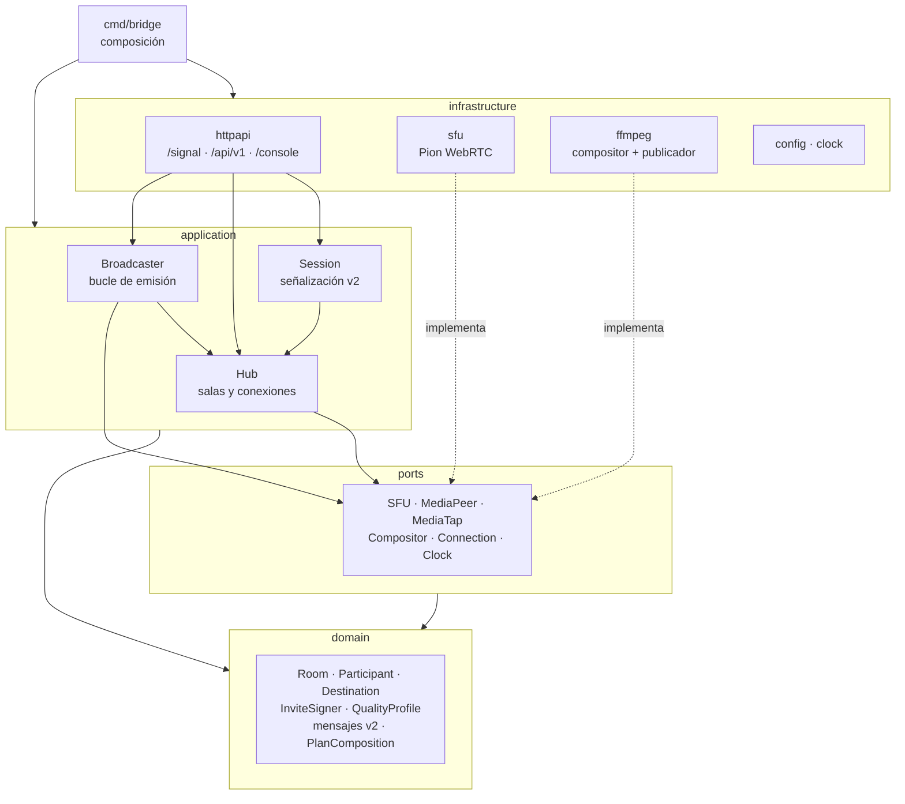
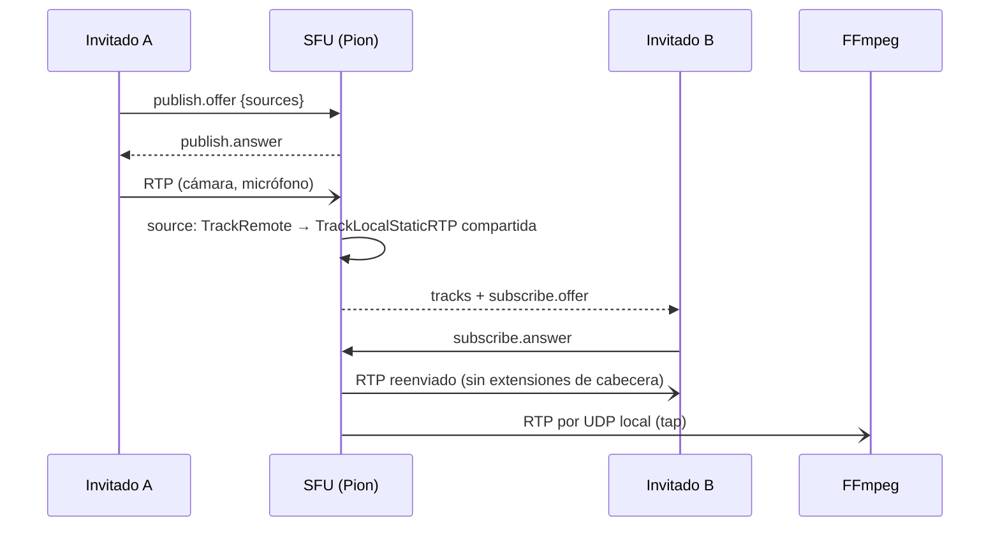

# Arquitectura

Hexagonal (regla 02), en `source/backend/go/bridge`; la regla de dependencias
la comprueba `tests/architecture`.

| Capa | Paquete | Responsabilidad |
|------|---------|-----------------|
| Dominio | `internal/domain` | Modelo puro: sala (aforo, escena, destinos), invitaciones HMAC, perfil, mensajes v2 y su validación, plan de composición (mosaico, foco) |
| Puertos | `internal/ports` | Interfaces hacia SFU, compositor, conexiones y reloj |
| Aplicación | `internal/application` | `Hub` (estado y difusión de presencia), `Session` (máquina de estados por socket), `Broadcaster` (recalcula el plan y lo aplica) |
| Infraestructura | `internal/infrastructure/*` | Pion, FFmpeg, HTTP/WebSocket, configuración |

## Medios

- Una `source` por pista publicada: un lector que copia cada paquete a una
  `TrackLocalStaticRTP` compartida (ligada a cada suscriptor) y a los *taps*
  del compositor. Las extensiones de cabecera se descartan: sus ids se
  negociaron en la conexión de publicación.
- PLI/FIR de los suscriptores se reenvían al emisor (limitados a uno cada
  500 ms).
- Códecs: Opus, VP8 y H.264 (los que todo navegador y FFmpeg manejan).

## Concurrencia

- El `Hub` usa un único mutex; nunca llama a adaptadores mientras lo tiene,
  salvo `Connection.Send`, que encola sin bloquear (cola de 256; un cliente
  que no lee se desconecta y puede reanudar).
- El SFU avisa de pistas nuevas o terminadas de forma asíncrona
  (`MediaListener`); el `Broadcaster` recibe "sala cambiada" del `Hub` y
  agrupa ráfagas (400 ms) antes de recalcular.

## Estado

En memoria: salas, destinos y participantes se pierden al reiniciar (ver
ROADMAP para persistencia).
