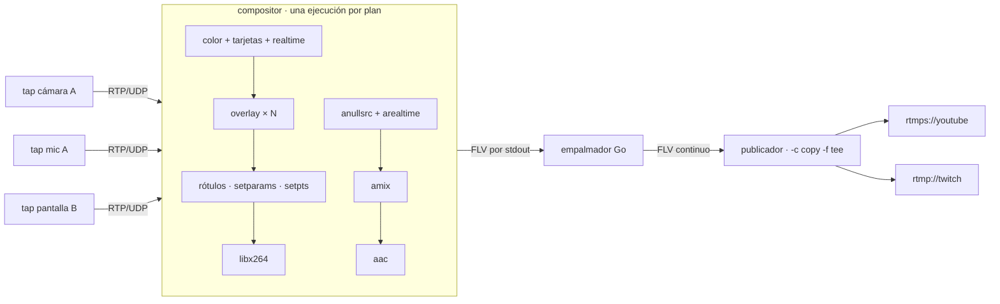

# Composición y publicación

## Plan de composición

`domain.PlanComposition(room, output, live)` produce un `CompositionPlan`
puro: una lista de *tiles* (rectángulo par, video o tarjeta, rótulo, foco) y
las fuentes de audio a mezclar.

- En escena: los participantes con `onStage` (por defecto todos), en orden
  de llegada.
- Cámara visible si está publicada, `cameraOff` es falso **y** llegan
  paquetes (`MediaTap.LastPacket` en los últimos 2.5 s). Si no, tarjeta con el
  nombre.
- Pantalla en foco (`auto`) mientras `screenSharing` y la pista entrega
  medios; las cámaras pasan a una columna a la derecha.
- Audio: micrófonos de quienes están en escena (silenciados incluidos: el
  navegador envía silencio) y el audio de la pantalla compartida.
- Sala vacía: el título y "Comenzamos en breve".

El `Broadcaster` recalcula el plan con cada cambio de sala y cada segundo
(liveness), y solo lo aplica si su firma cambió.

## Tubería FFmpeg

- Cada pista entra como un SDP (`127.0.0.1:<puerto par>`), con
  `-use_wallclock_as_timestamps 1` y `-copyts`: todas comparten el reloj de
  pared (sincronía por participante, sin deriva entre ellos). El fondo y el
  silencio se alinean a ese reloj (`RTCSTART`) y marcan el ritmo
  (`realtime`/`arealtime`); al final se rebasa a cero.
- Salida: x264 `veryfast`/`zerolatency`, GOP de 2 s, sin B-frames, CBR con el
  bitrate de `BRIDGE_OUTPUT`; AAC 48 kHz estéreo. Propiedades de color fijas
  (bt709, rango limitado) para que todas las ejecuciones produzcan el mismo
  SPS.
- **Publicador** de larga vida: `-c copy -f tee` con
  `onfail=ignore` por destino (un destino caído no tumba a los demás). Si
  muere del todo, se reinicia a los 2 s.

## Cambios de layout sin cortar la emisión

FFmpeg no admite cambiar entradas en caliente, así que cada plan nuevo
arranca **otra ejecución** del compositor (*make-before-break*):

1. La ejecución nueva arranca mientras la anterior sigue publicando; se piden
   keyframes a sus fuentes cada segundo hasta que produce.
2. Con su primer tag FLV de medios, el **empalmador** la pone al aire, mata a
   la anterior y reescribe sus marcas de tiempo sobre la línea temporal común
   (reloj desde el inicio, nunca hacia atrás). Cabeceras, metadatos y
   cabeceras de secuencia idénticas se descartan.
3. Si una ejecución no produce en 15 s se reintenta; la anterior sigue al aire.

Las conexiones RTMP(S) nunca se reabren por un cambio de layout. Solo un
cambio de destinos reinicia el flujo desde cero.

!!! info "Huecos conocidos"
    Si una entrada deja de enviar (cámara apagada con `replaceTrack(null)`,
    caída de red), `overlay`/`amix` esperan por ella y la ejecución en curso
    se congela hasta que la siguiente toma el relevo: ~2.5–4 s medidos en
    local y en contenedor (anuncio de `cameraOff` + arranque, o el detector de 2.5 s). Los
    servidores RTMP lo toleran (MediaMTX corta a los 10 s).

## Grabación local

`BRIDGE_RECORD_DIR` añade al `tee` un FLV por emisión (útil para auditar o
depurar una emisión).
