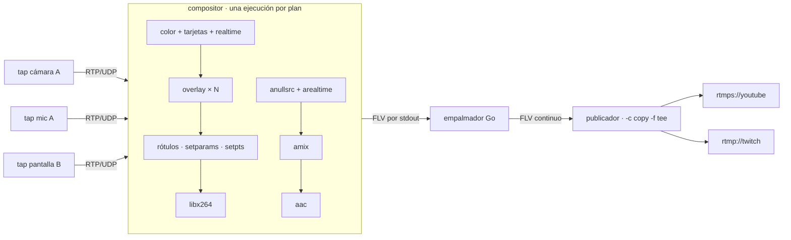

# Composición y publicación

## Plan de composición

`domain.PlanComposition(room, output, live)` produce un `CompositionPlan`
puro: una lista de *tiles* (rectángulo par, video o tarjeta, rótulo, foco) y
las fuentes de audio a mezclar.

- En escena: los participantes con `onStage` (por defecto todos), en orden
  de llegada.
- Cámara visible si está publicada, `cameraOff` es falso **y** llegan
  paquetes (`MediaTap.LastPacket` en los últimos 2.5 s). Si no, tarjeta con el
  nombre.
- Pantalla en foco (`auto`) mientras `screenSharing` y la pista entrega
  medios; las cámaras pasan a una columna a la derecha.
- Audio: micrófonos de quienes están en escena (silenciados incluidos: el
  navegador envía silencio) y el audio de la pantalla compartida.
- Sala vacía: el título y "Comenzamos en breve".

El `Broadcaster` recalcula el plan con cada cambio de sala y cada segundo
(liveness), y solo lo aplica si su firma cambió.

## Tubería FFmpeg

- Cada pista entra como un SDP (`127.0.0.1:<puerto par>`) y `-copyts` conserva
  los tiempos absolutos. El **vídeo** se sella con el reloj de pared
  (`-use_wallclock_as_timestamps 1`); el fondo y el silencio se alinean a ese
  reloj (`RTCSTART`) y marcan el ritmo (`realtime`/`arealtime`); al final se
  rebasa a cero.
- El **audio** (micrófonos y audio de pantalla) usa el reloj de medios RTP, no
  el de pared, y se marca por conteo de muestras (`asetpts=N/SR/TB`), sin
  `aresample async`. Sellar los paquetes de audio con su hora de llegada (que es
  a ráfagas) hacía que `aresample async=1000` insertara bloques de 0.34 s de
  silencio (149 en 45 s), descartara ~5 600 muestras y comprimiera la señal un
  2 % de forma continua; FFmpeg dejaba de leer esas entradas, sus colas UDP se
  llenaban (~330 KB) y el kernel perdía entre el 5 y el 16 % de los paquetes:
  audio cortado y vídeo degradado en el restream.
- Salida: x264 `veryfast`/`zerolatency`, GOP de 2 s, sin B-frames, CBR con el
  bitrate de `BRIDGE_OUTPUT`; AAC 48 kHz estéreo. Propiedades de color fijas
  (bt709, rango limitado) para que todas las ejecuciones produzcan el mismo
  SPS.
- **Publicador** de larga vida: `-c copy -f tee` con
  `onfail=ignore` por destino (un destino caído no tumba a los demás). Si
  muere del todo, se reinicia a los 2 s.

## Layout por voz

Con `layout: "active"` el foco (la baldosa grande) sigue a quien habla, y el resto queda en la columna.
El puente lo deduce del **nivel de audio que cada navegador ya envía en sus paquetes RTP** (extensión
`urn:ietf:params:rtp-hdrext:ssrc-audio-level`, RFC 6464): no decodifica audio ni añade WASM, y el contrato
con el webrelay no cambia. Un navegador que no la ofrezca simplemente no puede tomar el foco (se queda el
primero en escena).

Cada cambio de foco es una recomposición (≈2 s de corte, ver más abajo), así que el seguimiento es lento y
pegajoso a propósito (`domain.SpeakerTracker`):

- Una persona es candidata cuando el ≥35 % de la última ~½ s fue voz, y debe seguir así **1,2 s** antes de
  tomar el foco (una tos o una palabra no lo mueve).
- Quien tiene el foco lo conserva mientras siga hablando (≥12 %), aunque otro lo interrumpa.
- Entre dos cambios pasan **al menos 8 s**.
- Si quien tenía el foco sale de escena, el siguiente que hable lo toma de inmediato.
- Sin nadie hablando, el foco es el primer invitado en escena (como `speaker`).

El seguimiento solo corre **con la emisión en el aire** (sin emisión no hay nada que recomponer): `activeSpeaker`
en el estado de la sala sigue vacío hasta entonces. En el log: `active speaker changed room=… participant=…`.

Verificado con Chrome real y el puente real: dos invitados con micrófono sintético, y el foco pasa de uno a
otro a los ~2 s de que cambie quién suena.

## Cambios de layout sin cortar la emisión

FFmpeg no admite cambiar entradas en caliente, así que cada plan nuevo
arranca **otra ejecución** del compositor (*make-before-break*):

1. La ejecución nueva arranca mientras la anterior sigue publicando; se piden
   keyframes a sus fuentes de inmediato y cada 100 ms hasta que produce
   (FFmpeg abre las entradas una a una y cada decodificador necesita un
   keyframe posterior a la apertura de su socket; con un reintento de 1 s
   cada entrada de video costaba un segundo entero, con 250 ms ≈ 0,3 s). Chrome
   fusiona las peticiones seguidas (medido: 89 PLI recibidos, 36 keyframes
   codificados, sin más bytes subidos), así que apretar el reintento no cuesta
   ancho de banda al invitado.
2. Con su primer tag FLV de medios, el **empalmador** la pone al aire, mata a
   la anterior y reescribe sus marcas de tiempo sobre la línea temporal común
   (reloj desde el inicio, nunca hacia atrás). Cabeceras, metadatos y
   cabeceras de secuencia idénticas se descartan.
3. Si una ejecución no produce en 15 s se reintenta; la anterior sigue al aire.

Las conexiones RTMP(S) nunca se reabren por un cambio de layout. Solo un
cambio de destinos reinicia el flujo desde cero.

!!! info "Huecos conocidos"
    Si una entrada deja de enviar (cámara apagada con `replaceTrack(null)`,
    caída de red), `overlay`/`amix` esperan por ella y la ejecución en curso
    se congela hasta que la siguiente toma el relevo: ~2.5–4 s medidos en
    local y en contenedor (anuncio de `cameraOff` + arranque, o el detector de 2.5 s). Los
    servidores RTMP lo toleran (MediaMTX corta a los 10 s).

## Grabación local

`BRIDGE_RECORD_DIR` añade al `tee` un FLV por emisión (útil para auditar o
depurar una emisión).

## Diagnóstico de la emisión

Cuando un destino (YouTube, Twitch…) corta la emisión, el bridge deja rastro suficiente para saber
**quién** cortó y **por qué**, y se repara solo. Todo sale por el log estructurado del bridge
(`kubectl logs deploy/ether-bridge`); las claves de emisión nunca aparecen (se ocultan como `••••`).

### Qué se registra

| Mensaje | Nivel | Cuándo | Campos útiles |
|---|---|---|---|
| `broadcast health` | INFO | cada 30 s mientras todo va bien | `out_kbps`, `video_tags_per_s`, `last_tag_age_ms`, `max_write_ms`, `inputs` (cuánto hace que cada fuente entregó un paquete), `restarts` |
| `broadcast unhealthy` | WARN | cada 5 s (las 3 primeras; luego una de cada 6) si hay un problema | `problems`: `output stalled`, `publisher not reading … backpressure`, `0 bytes sent`; más los campos de arriba |
| `publisher exited; restarting` | WARN | el publicador murió (la plataforma cerró, la red cayó…) | `kind`, `destination`, `uptime`, `sent_bytes`, `last_tag_age_ms`, `since_last_recompose`, `fail_streak`, `retry_in`, `tail` (las últimas 20 líneas de FFmpeg, ya sin claves) |
| `output stalled; restarting the compositor run` | ERROR | la salida lleva ≥ 10 s sin escribir tramas | `tag_age_ms`, `attempt` |
| `output still stalled; restarting the publisher` | ERROR | dos reinicios del compositor no bastaron | `tag_age_ms`, `fail_streak`, `retry_in` |
| `compositor exited` | WARN | murió la ejecución en el aire | `kind`, `lived`, `tail` |
| `compositor on air` | INFO | una ejecución empieza a publicar | `run`, `startup_ms` (lo que tardó en dar su primer fotograma) |
| `recomposing` | INFO | cambió el plan | `reason`: `video+=p-2/camera`, `video-=p-1/screen`, `tiles=3->4`… |
| `source stopped delivering media` / `source delivering media again` | INFO | una cámara, pantalla o micro deja de entregar paquetes (2,5 s) y cuando vuelve | `source`, `silent_for` |

### Causas (`kind`)

| `kind` | Qué significa | Primera comprobación |
|---|---|---|
| `remote-closed` | La plataforma cerró la conexión (`Broken pipe`, `Connection reset`) | Panel de la plataforma: ¿terminó la emisión?, ¿avisos de salud del stream?, ¿otra emisión con la misma clave? |
| `timeout` | Nada pasó en el tiempo previsto | Red del VPS; `max_write_ms` alto justo antes |
| `rejected` | Clave o permisos rechazados (4xx, handshake) | Clave de emisión, emisión creada y habilitada |
| `dns` | No resolvió el host de ingesta | DNS del VPS / URL del destino |
| `refused` | Conexión rechazada o sin ruta | URL y puerto del destino; salida de red del pod |
| `encoder` | FFmpeg falló por sí mismo | `tail`; recursos del pod |
| `stall` | La salida se congeló y el vigilante lo reparó | `inputs` y la CPU del pod |

### Cómo leerlo, ejemplos

- **El corte llegó de la plataforma**: `publisher exited … kind=remote-closed … uptime=3m12s`. Si poco antes
  hay `broadcast unhealthy … backpressure … max_write_ms=…`, la subida estaba congestionada; si no,
  la plataforma cortó por su cuenta (mira su panel).
- **Cortó justo tras un cambio de layout**: `since_last_recompose` pequeño en el mismo mensaje, y un
  `recomposing reason=…` poco antes.
- **La imagen se quedó con una tarjeta**: `source stopped delivering media source=p-1/screen silent_for=…`;
  la causa está en el navegador del invitado, no en el servidor.
- **Salida casi sin CPU**: es normal con imagen estática; `out_kbps` y `video_tags_per_s` dicen si
  salen tramas (≈ 30/s) o si de verdad se paró.

### Reparación automática

- **Reinicio con retroceso**: tras un fallo del publicador se reintenta a los 2 s, luego 4, 8, 16 y
  hasta 30 s (`retry_in`, `fail_streak`); un publicador que vivió un minuto reinicia el contador. Así no
  se martillea a una plataforma que acaba de cortar.
- **Vigilante de atascos**: si la emisión está en el aire y no se escribe ninguna trama en 10 s, arranca
  una ejecución nueva del compositor (la congelada se descarta al tomar el relevo); si tras dos
  intentos sigue atascada, reinicia también el publicador. Los intentos se espacian 15 s.

Los tiempos (5 s de revisión, 30 s de resumen, 10 s de atasco) son variables del paquete `ffmpeg`
(`health.go`, `diagnose.go`); las pruebas los acortan para comprobar el comportamiento real con FFmpeg.

## Subtítulos en vivo

Con `captions: true` en la sala, cada invitado que lo elija transcribe su micrófono en su navegador y envía la frase
que dice ([`caption`](signaling.md)). El puente dibuja la última frase en la parte baja de la emisión, centrada, con
caja translúcida, dos líneas como máximo (`Nombre: texto`; si no cabe, se muestran las palabras más recientes tras «…»)
y la borra a los 6 s sin otra nueva. Solo cuentan los invitados **en escena**.

**Sin recomponer.** El texto cambia cada segundo, y cada recomposición cuesta un corte de ~2 s, así que no forma parte
del plan: el plan solo dice *si* hay subtítulos (`captions` en `CompositionPlan`; activarlos recompone una vez). El texto
vive en `<sala>/caption.txt` y el filtro `drawtext` lo relee en cada fotograma (`reload=1`); el puente lo reescribe con un
reemplazo atómico (`caption.txt.tmp` + `rename`), de modo que FFmpeg nunca ve una frase a medias. Un archivo vacío no
dibuja nada, ni siquiera la caja. La prueba con FFmpeg real
(`TestCaptionsChangeInPlaceWithoutRecomposing`) comprueba que el texto cambia en el vídeo con una sola ejecución del
compositor.

El tamaño de letra y los caracteres por línea salen del tamaño de la emisión (`domain.CaptionLayout`).
Sin fuente instalada (`BRIDGE_FONT_FILE`) no se dibuja ningún texto, tampoco los subtítulos.
