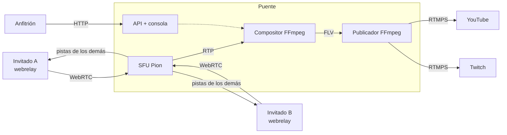

# Ether streaming bridge (`ether-streaming-culerin`)

El **puente** de Ether: alberga la videollamada a la que entran los invitados
desde el [webrelay](https://github.com/rafex/ether-webrelay), **compone** la
sala en un solo video con audio mezclado y la **publica en RTMP(S)** (YouTube,
Twitch, Facebook o un servidor propio). El anfitrión lo controla con una API
REST y una consola web.

- [Guía de inicio](getting-started.md) — levantar puente + webrelay + MediaMTX en local.
- [Desplegar el puente](running-bridge.md) — contenedor, red, TLS, ICE.
- [Configuración](configuration.md) — variables `BRIDGE_*`.
- [API del anfitrión](api.md) — salas, invitaciones, destinos, emisión.
- [Arquitectura](architecture.md) — hexágono, SFU, sesiones de señalización.
- [Composición y publicación](composition.md) — FFmpeg, layouts, empalme sin cortes.
- [Señalización](signaling.md) — cómo implementa el contrato v2 del webrelay.

!!! note "Contrato con el webrelay"
    El contrato vive en el webrelay:
    [`docs/signaling.md`](https://github.com/rafex/ether-webrelay/blob/main/docs/signaling.md).
    El E2E de ese repositorio se ejecuta contra este puente (`make e2e`).
